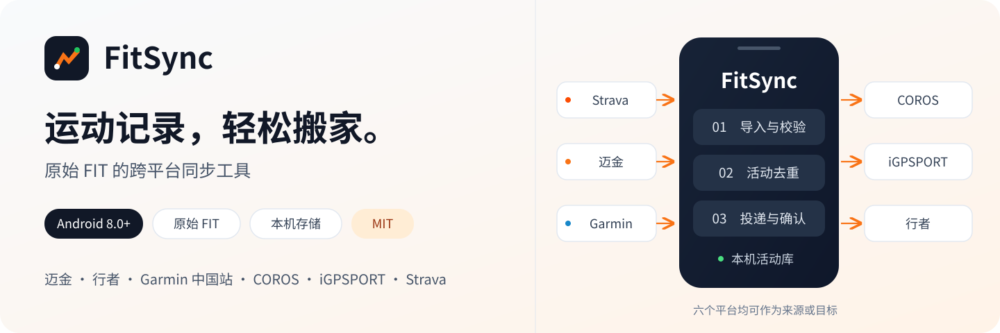
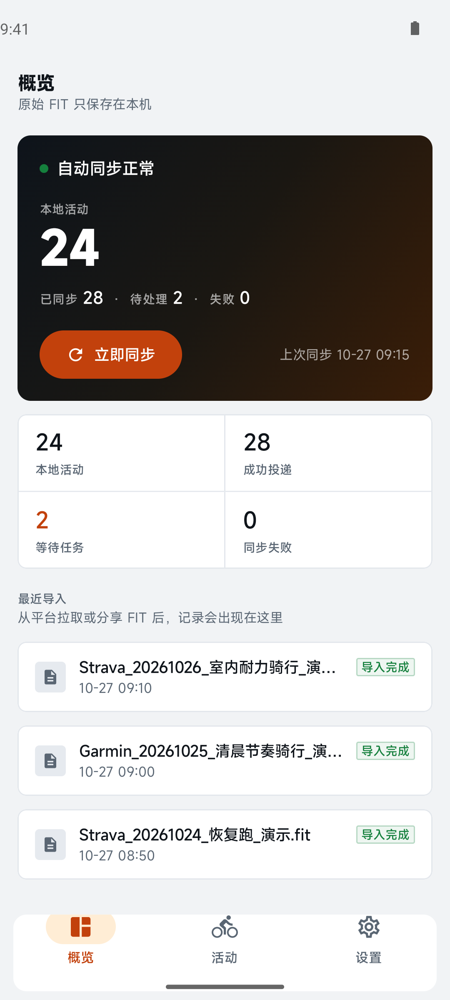
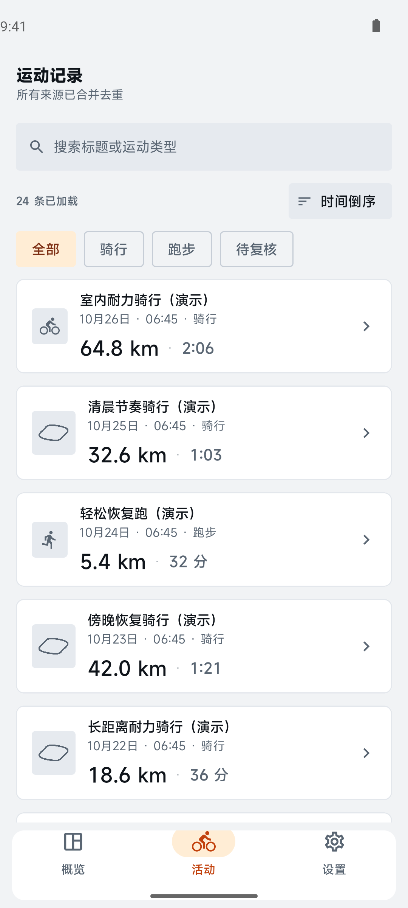
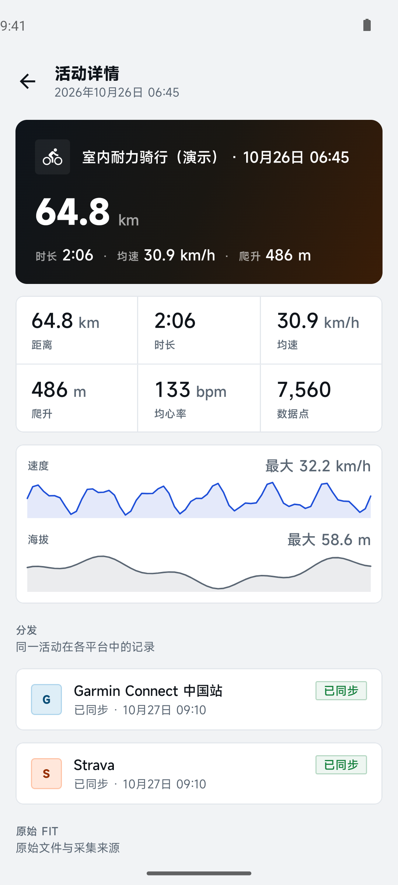
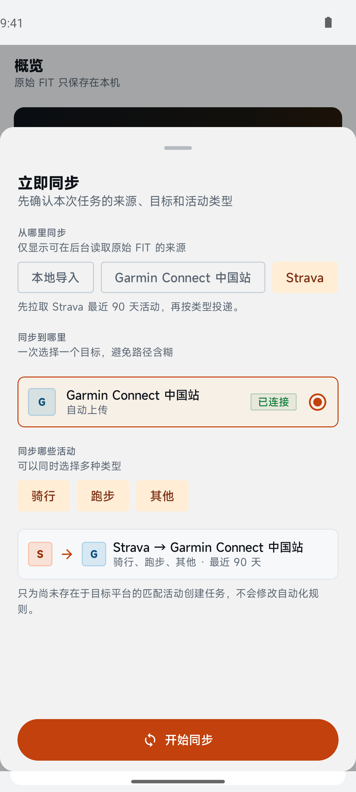
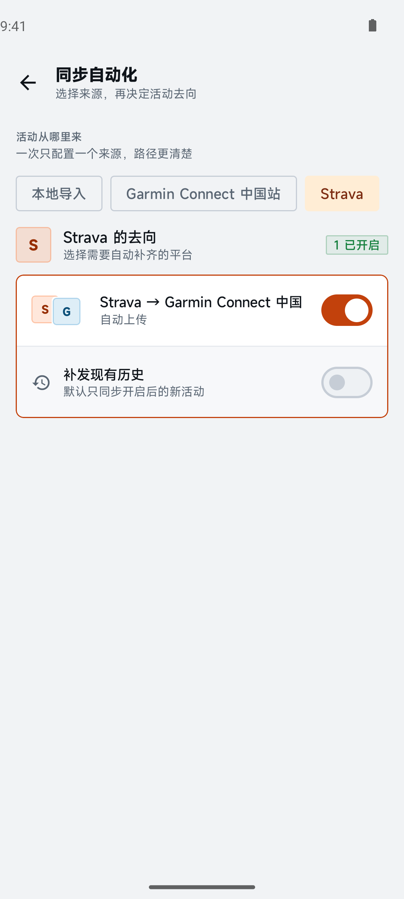
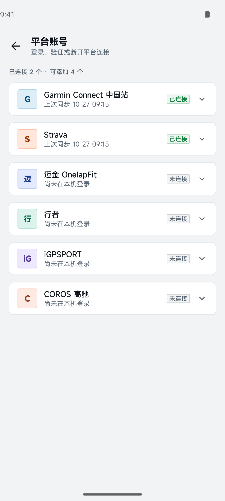
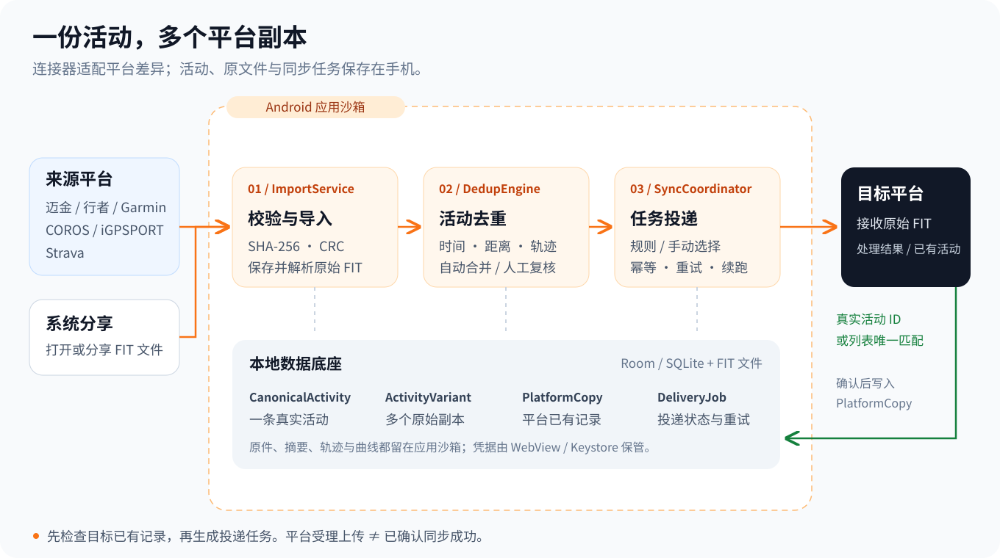
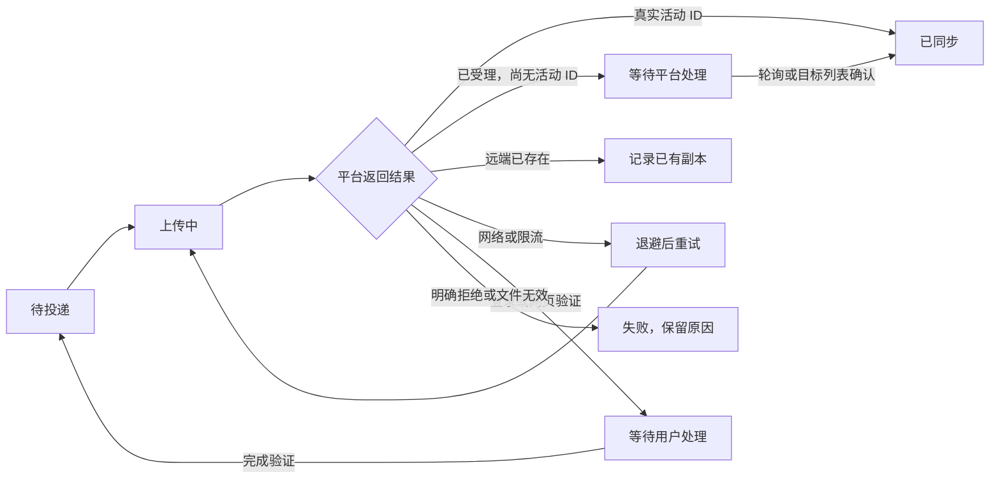

<p align="center">
  
</p>

<p align="center">
  <b>把分散在不同平台的运动记录，搬到你想用的地方。</b><br />
  纯 Android · 原始 FIT · 本机存储 · 无自建服务器
</p>

<p align="center">
  <a href="https://litianfu1997.github.io/fit-sync-app/">项目主页</a> ·
  <a href="https://github.com/litianfu1997/fit-sync-app/releases/latest">下载 Android 版</a> ·
  <a href="#界面预览">界面预览</a> ·
  <a href="#支持的平台">支持的平台</a> ·
  <a href="#开始使用">开始使用</a> ·
  <a href="#工作原理">工作原理</a> ·
  <a href="#构建与测试">构建与测试</a>
</p>

# FitSync

FitSync（骑行记录搬家）是一款在 **迈金 ONELAP、行者、Garmin Connect 中国站、COROS、iGPSPORT 和 Strava** 之间搬运、补齐原始 FIT 活动的 Android 应用。以骑行为主，也支持平台能够提供 FIT 的跑步等活动。

活动库、原始文件、去重结果和同步任务都保存在手机的应用沙箱中。手机直接访问你登录的平台，**不需要部署 FitSync 服务器**。

## 能做什么

- **跨平台补齐活动**：选择来源、目标和运动类型，执行一次同步；也可以开启长期自动同步规则。
- **收集原始 FIT**：从已连接的平台下载，或通过 Android 的分享、打开文件入口导入。
- **同一活动合并展示**：保留不同平台、设备的原始副本，结合时间、距离、轨迹等信息识别重复；不确定的候选留给用户复核。
- **避免重复与循环上传**：记录活动在各平台账号上的副本，并为投递任务生成幂等键。
- **任务可以续跑**：持久化排队、平台处理等待和重试状态，登录失效时提示重新验证。
- **查看活动细节**：浏览距离、时长等指标，以及可用的轨迹地图、速度和海拔曲线。

## 界面预览

以下为当前应用在 Android 模拟器中的实际截图，使用合成活动和演示账号，不包含真实账号凭据或个人路线。演示环境关闭网络，平台状态与任务记录用于展示界面。

<table>
  <tr>
    <td align="center"><b>同步概览</b><br /></td>
    <td align="center"><b>运动记录</b><br /></td>
    <td align="center"><b>活动详情</b><br /></td>
  </tr>
  <tr>
    <td align="center"><b>一次性同步</b><br /></td>
    <td align="center"><b>同步自动化</b><br /></td>
    <td align="center"><b>平台账号</b><br /></td>
  </tr>
</table>

[截图与配图说明](docs/assets/README.md)

## 支持的平台

下表描述当前仓库的实现能力。后台操作需要有效的登录会话；平台接口、网页变化或风控都可能影响可用性。实验性连接请先用少量活动验证。

| 平台 | 列出活动 | 下载原始 FIT | 上传 FIT | 登录方式与范围 | 状态 |
| --- | :---: | :---: | :---: | --- | --- |
| 迈金 ONELAP | ✓ | ✓ | ✓ | 内置网页登录，复用 Cookie / 令牌 | 已实现 |
| 行者 | ✓ | ✓ | ✓ | 内置网页登录，复用会话 | 实验性 |
| Garmin Connect | ✓ | ✓ | ✓ | 内置网页登录，**仅中国站** | 实验性 |
| COROS 高驰 | ✓ | ✓ | ✓ | 账号密码登录，**仅中国站** | 实验性 |
| iGPSPORT | ✓ | ✓ | ✓ | 账号密码登录，**仅中国站** | 实验性 |
| Strava | ✓ | ✓ | ✓ | 内置网页登录，复用网页会话 | 实验性 |

Strava 当前使用网页活动列表、原文件导出与上传流程，**不需要配置开发者应用、Client ID 或 Client Secret**。这些网页流程并非 Strava 公开 API 集成。

每个平台最多绑定一个账号。原平台没有提供原始 FIT 的活动，无法自动搬运；TCX、GPX 不会被当作 FIT 导入。

完整协议、执行模式和限制见 [平台能力矩阵](docs/platform-capabilities.md) 与 [Strava 网页同步说明](docs/strava-integration-plan.md)。

## 开始使用

### 1. 安装并连接平台

按下方步骤构建 APK 并安装，打开 **设置 → 平台账号**，登录需要使用的平台。网页登录时完成平台要求的验证，再按页面提示验证并保存登录；COROS、iGPSPORT 使用应用内的账号密码登录入口。

### 2. 选择一次同步，或开启自动化

| 使用场景 | 操作 | 作用范围 |
| --- | --- | --- |
| 现在补齐一批活动 | 概览 → 立即同步 → 选择来源、目标和运动类型 → 确认同步 | 仅本次任务，不修改长期规则 |
| 今后自动搬运新活动 | 设置 → 同步自动化 → 选择来源 → 开启目标平台 | 默认只处理规则开启后的新活动 |
| 同时补齐已有历史活动 | 在对应自动化路径中开启“补发现有历史”，确认后提交 | 在配置的历史拉取范围内补齐活动 |
| 只有一个 FIT 文件 | 在文件管理器或其他应用中分享、打开 FIT，选择 FitSync | 导入后可在活动详情中向目标平台补发 |

首次和手动全量拉取默认检查 **最近 90 天**，可在 **设置 → 数据与存储** 调整。增量拉取保留 48 小时重叠窗口。

“本地导入”作为同步来源时，表示已经进入本机活动库的全部活动，包括之前从平台下载的活动。

### 3. 允许后台运行

在 **设置 → 后台运行** 检查通知权限、电池优化和后台限制，并按机型允许必要的后台、自启动行为。周期同步由 WorkManager 调度，配置间隔至少 15 分钟，实际执行时间受 Android 和厂商省电策略影响。

## 工作原理



1. **先检查目标平台**：刷新目标账号已有活动，再拉取来源，减少因本机记录不完整造成的重复上传。
2. **统一导入原文件**：将 FIT 复制到沙箱，计算 SHA-256，校验完整性和 CRC，解析活动指标。
3. **区分活动与副本**：一条真实活动对应一个 `CanonicalActivity`；不同来源的 FIT 保留为多个 `ActivityVariant`。相似度足够高时自动合并，边界情况等待人工复核。
4. **按规则创建任务**：`SyncRule` 或本次手动选择生成 `DeliveryJob`；活动在目标已有 `PlatformCopy` 时跳过，文件与目标账号共同形成幂等键。
5. **确认后再标记成功**：只有得到真实远端活动 ID，或在目标列表找到唯一高置信匹配，才写入平台副本。平台仅“受理上传”时继续等待确认，不会因此反复提交同一个 FIT。

任务状态会持久化在本机；网络异常按退避策略重试，需要登录或网页操作时保留任务并通知用户。



开发者可继续阅读 [架构与数据流](docs/architecture.md)。

## 隐私与数据

- **本机保管**：活动库、任务和 FIT 文件存于应用沙箱，不经 FitSync 自建服务器；同步时手机会直接向用户选择的平台发送活动文件。
- **登录凭据**：网页登录 Cookie 保存在本机 WebView 会话中；需要额外持久化的敏感令牌由 Android Keystore 加密。COROS、iGPSPORT 的账号密码也经 Keystore 加密保存，用于令牌失效后的自动重登。
- **地图联网**：详情和全屏地图使用 osmdroid / OpenStreetMap 瓦片；加载地图时会访问地图瓦片服务。
- **文件保留策略**：默认在满足同步成功条件并经过 7 天后清理原始 FIT；可改为长期保留或成功后删除。清理原文件会保留活动元数据，之后补发可能需要重新下载原件。
- **备份与换机**：Android 自动备份已关闭，当前没有完整的换机迁移或导出备份流程。卸载前请自行保留需要的原始文件。

## 构建与测试

### 环境

- Android 8.0（API 26）及以上设备。
- JDK 17+；本项目使用 JDK 21 验证构建。
- Android SDK Platform 34、对应 Build Tools；Gradle 8.7 由仓库 Wrapper 提供。
- Android SDK 路径使用已有的 `ANDROID_HOME` 或本机 `local.properties` 中的 `sdk.dir`，保留有效配置即可。

本机构建默认优先通过阿里云 Maven 镜像解析，并配置官方仓库作为后备。GitHub Actions 设置 `FITSYNC_USE_MAVEN_MIRRORS=false`，直接使用 Google Maven、Maven Central 和 Gradle Plugin Portal。

### Debug 构建

Windows PowerShell：

```powershell
# 改为本机 JDK 17+ 目录；默认 Java 版本过低时需要显式设置。
$env:JAVA_HOME = "D:\jdk-21"
.\gradlew.bat :app:assembleDebug
.\gradlew.bat :app:testDebugUnitTest
```

macOS / Linux：

```bash
chmod +x gradlew
export JAVA_HOME="/path/to/jdk-21"
./gradlew :app:assembleDebug
./gradlew :app:testDebugUnitTest
```

APK 输出：`app/build/outputs/apk/debug/app-debug.apk`。连接设备或模拟器后可执行：

```bash
adb install -r app/build/outputs/apk/debug/app-debug.apk
./gradlew :app:connectedDebugAndroidTest
```

Windows 使用 `gradlew.bat` 替换上例中的 `./gradlew`。仪表化测试包含 Room 迁移与 Compose 组件测试，需要已启动的设备或模拟器。

### Release 签名

自行创建签名密钥，并在仓库根目录创建 `keystore.properties`：

```properties
storeFile=keystore/fitsync-release.jks
storePassword=替换为本机密钥库密码
keyAlias=fitsync
keyPassword=替换为本机密钥密码
```

```bash
./gradlew :app:assembleRelease
```

`keystore.properties`、`keystore/` 和密钥文件已加入忽略规则。缺少签名配置时 Release 构建会失败，Debug 构建不受影响。

### GitHub 手动构建与发布

仓库提供 **手动构建并发布 APK** 工作流：在 GitHub **Actions → 手动构建并发布 APK → Run workflow** 点击运行，通过单元测试与签名校验后，APK 会自动发布到 **Releases**。推送代码不会触发构建。

首次使用需要配置四个正式签名 Secrets；版本号可在运行时填写，安装版本号自动递增。配置与操作步骤见 [GitHub 手动发布指南](docs/github-actions.md)。

## 工程结构

```text
app/src/main/java/com/fitsync/app/
├── connectors/   六个平台的连接器、协议与能力声明
├── data/         Room 数据库、文件存储、导入与维护
├── domain/       去重策略、领域模型与枚举
├── fit/          FIT 校验、解析、轨迹与曲线编解码
├── notification/ 同步进度与需要操作的通知
├── share/        Android 分享与文件导入入口
├── sync/         规则规划、任务编排与 WorkManager
├── ui/           Jetpack Compose + Material 3 界面
└── web/          WebView 登录、会话与网页流程
benchmark/        Macrobenchmark 与 Baseline Profile
docs/             平台说明、架构、截图与配图
```

主要技术：**Kotlin · Jetpack Compose · Material 3 · Room / SQLite · WorkManager · OkHttp · osmdroid**。依赖由 `FitSyncApp` 组装，不使用 Hilt / Dagger；FIT 解析由本地轻量引擎完成。

## 常见问题

**上传了，为什么还没有显示“已同步”？**

部分平台异步处理文件。FitSync 会在远端活动确认后更新副本状态；处理期间会继续轮询或检查目标列表。已经显示“已同步”的活动无需再次补发。

**为什么旧活动没有进入队列？**

检查历史拉取天数、所选运动类型，以及自动化路径是否开启“补发现有历史”。默认规则只发送开启后的新活动。

**登录失效或平台接口变化怎么办？**

在“平台账号”中重新登录、验证，随后查看同步任务的具体原因。多数连接依赖平台网页或非公开接口，不能保证长期稳定，也不绕过验证码和二次认证。

**能在 iPhone、网页或自建服务器上运行吗？**

目前仅提供 Android 应用，没有 iOS 客户端、Web 版或独立后端。

## 参与贡献

欢迎提交问题、平台适配和改进建议。反馈同步问题时，请提供应用版本、Android 版本、平台及区域、复现步骤和脱敏后的错误信息；请隐藏账号、Cookie、令牌与私人路线。

修改平台协议时，尽量附上不含凭据的响应样例和对应解析测试；修改 Room 实体时补齐迁移，修改 FIT 解析结果时同步更新解析器版本。

- [提交问题](https://github.com/litianfu1997/fit-sync-app/issues)
- [平台能力与执行模式](docs/platform-capabilities.md)
- [架构与数据流](docs/architecture.md)
- [Strava 网页同步说明](docs/strava-integration-plan.md)

## 许可证

本项目采用 [MIT License](LICENSE)。许可标准文本见 [Open Source Initiative](https://opensource.org/license/mit)。第三方依赖和平台名称、商标分别遵循其自身许可与权利归属。
