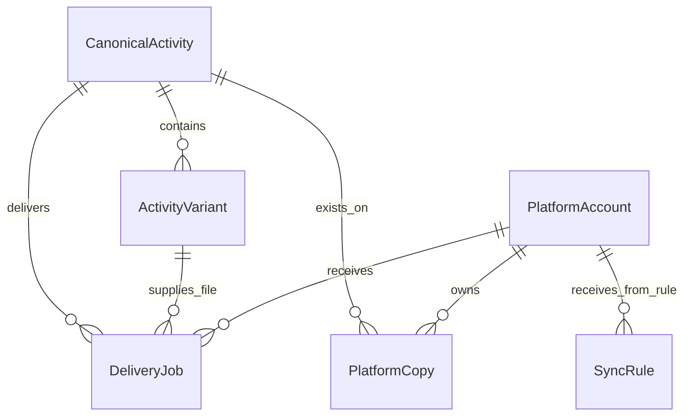
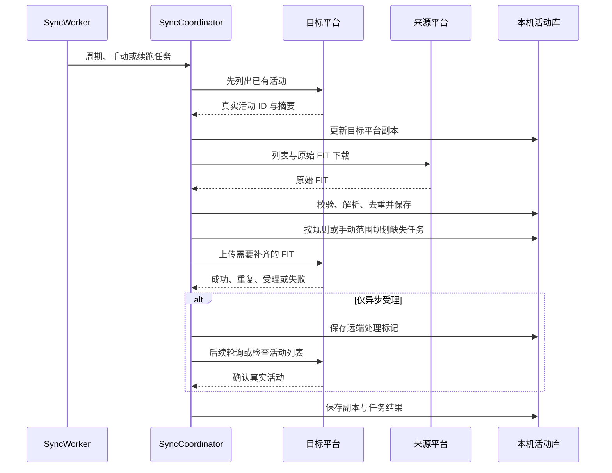

# 架构与数据流

FitSync 的运行单元是 Android 应用。手机直接访问各平台，活动库、FIT 文件和任务队列保存在应用沙箱中，没有独立后端。

[返回项目首页](../README.md) · [平台能力与执行模式](platform-capabilities.md)

## 组件分工

| 组件 | 负责的工作 |
| --- | --- |
| `FitSyncApp` | 统一组装数据库、连接器、导入、同步、通知等共享组件 |
| `PlatformConnector` / `ConnectorRegistry` | 隔离平台登录校验、分页列表、FIT 下载、上传与状态查询 |
| `ImportService` / `FitEngine` | 保存原始文件、校验 SHA-256 / CRC、解析活动、识别重复 |
| `DedupEngine` | 对候选活动评分，决定新建、自动合并或人工复核 |
| `DeliveryPlanner` | 根据手动选择或启用规则，生成缺失目标平台的投递任务 |
| `SyncCoordinator` | 协调目标检查、来源拉取、规则规划、投递、结果确认和失败恢复 |
| `SyncWorker` / WorkManager | 调度手动同步、周期同步及投递续跑 |
| `FitStorageJanitor` | 按保留策略清理已满足条件的原始文件，保留元数据与副本映射 |

UI 使用 Jetpack Compose / Material 3，通过 Room Flow 观察本机状态。地图和曲线使用已解析的轨迹、采样数据；地图底图需要联网读取瓦片。

## 一条活动与多个副本

平台上的记录和 FIT 文件不是同一个概念。一个平台活动可以已经存在，但原始文件尚未下载；多个设备也可能为同一场骑行生成不同的 FIT。

- `CanonicalActivity`：去重后的一条真实活动，持有汇总指标与主副本 ID。
- `ActivityVariant`：一个原始 FIT 文件，按文件 SHA-256 唯一，可保留设备、采集平台、轨迹与曲线。
- `PlatformCopy`：活动已经存在于某个平台账号上的记录，以真实远端活动 ID 标识。
- `DeliveryJob`：一次向指定目标账号投递指定 FIT 的任务，持有状态、重试和远端处理标记。
- `SyncRule`：来源平台到目标账号的长期自动化规则；历史补发单独开启。

图中为逻辑关联。实体通过 ID 关联；`PlatformCopy` 对“活动 + 目标账号”和“目标账号 + 远端活动 ID”设有唯一索引，`DeliveryJob` 同时对“活动 + 目标账号”和幂等键设唯一约束。

## 导入与去重

导入先把 FIT 保存到本机并计算 SHA-256。同文件已存在时直接复用；新文件经过完整性 / CRC 校验与解析后，再进入活动相似度判断。

候选优先按开始时间 ±10 分钟、运动类型和距离兼容性过滤。正常距离值采用 8% 容差，缺少距离或室内活动按实际可用信息回退。评分维度如下：

| 维度 | 权重 |
| --- | ---: |
| 开始时间 | 25 |
| 轨迹 | 25 |
| 活动时长 | 15 |
| 距离 | 15 |
| 移动时长 | 10 |
| 设备与传感器信号 | 10 |

相似度 **≥92** 自动合并，**≥75 且 <92** 标记待复核，其余创建新活动。自动合并保留原始副本，不把两个文件简单覆盖成一个。

FIT 解析结果发生变更时，需要更新解析器版本，历史数据才会分批重算；原文件已清理的活动需在界面上使用已有摘要回退。

## 一次同步的顺序

目标检查未正常完成时，来源规划与投递会受到限制，避免在无法判断目标已有内容时盲目补发。手动同步只影响选定的来源、目标、类型和历史范围，不写入长期规则。

首次与手动全量检查使用配置的历史天数，默认 90 天；增量同步从上次成功时间向前重叠 48 小时。全量检查从第一页开始，避免复用旧分页游标遗漏活动。

## 上传确认与重试

“HTTP 请求成功”与“目标平台已创建活动”需要分别处理。OSS 对象 ID、临时 upload ID 或文件 MD5 都不能直接当作远端活动 ID。

`DeliveryJob` 在异步受理后进入 `WAITING_REMOTE_PROCESS`，保存后续查询所需标记；通过真实状态接口或目标列表的唯一高置信匹配确认后，才写入 `PlatformCopy`。轮询不重新 POST 同一个文件。

登录或网页验证要求转为 `WAITING_USER`；网络、限流和可恢复服务异常进入退避重试；明确的文件拒绝保留错误原因。`ConnectorResult` 统一表达这些结果，由编排层决定状态迁移。

WorkManager 按系统条件调度，数据库保存任务进度。应用不以常驻进程保证精确的 15 分钟执行时间；具体后台限制见 [平台能力文档](platform-capabilities.md#后台同步与系统限制)。
